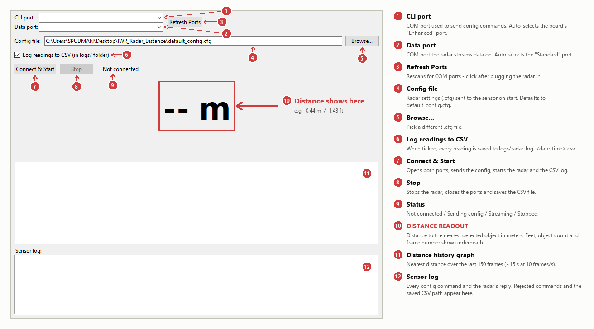
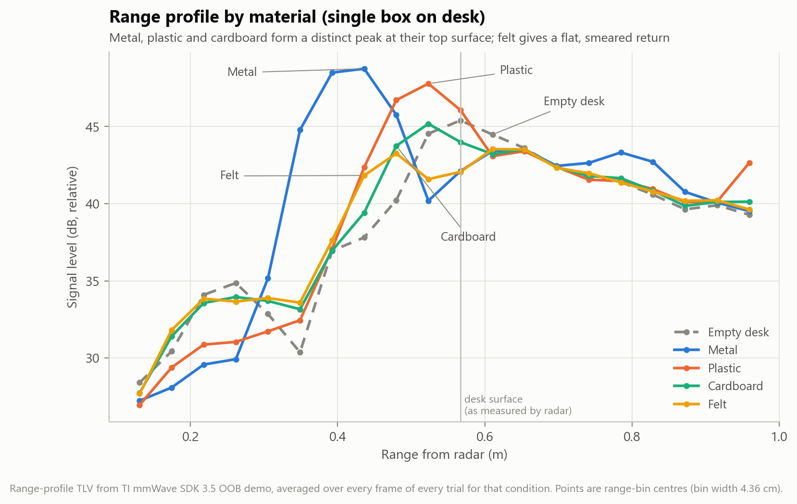
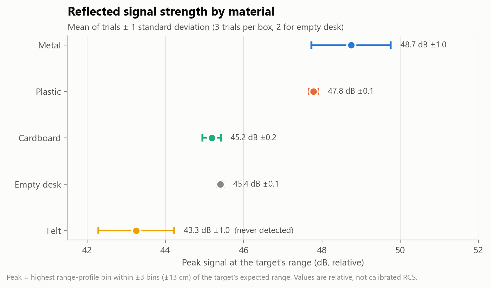
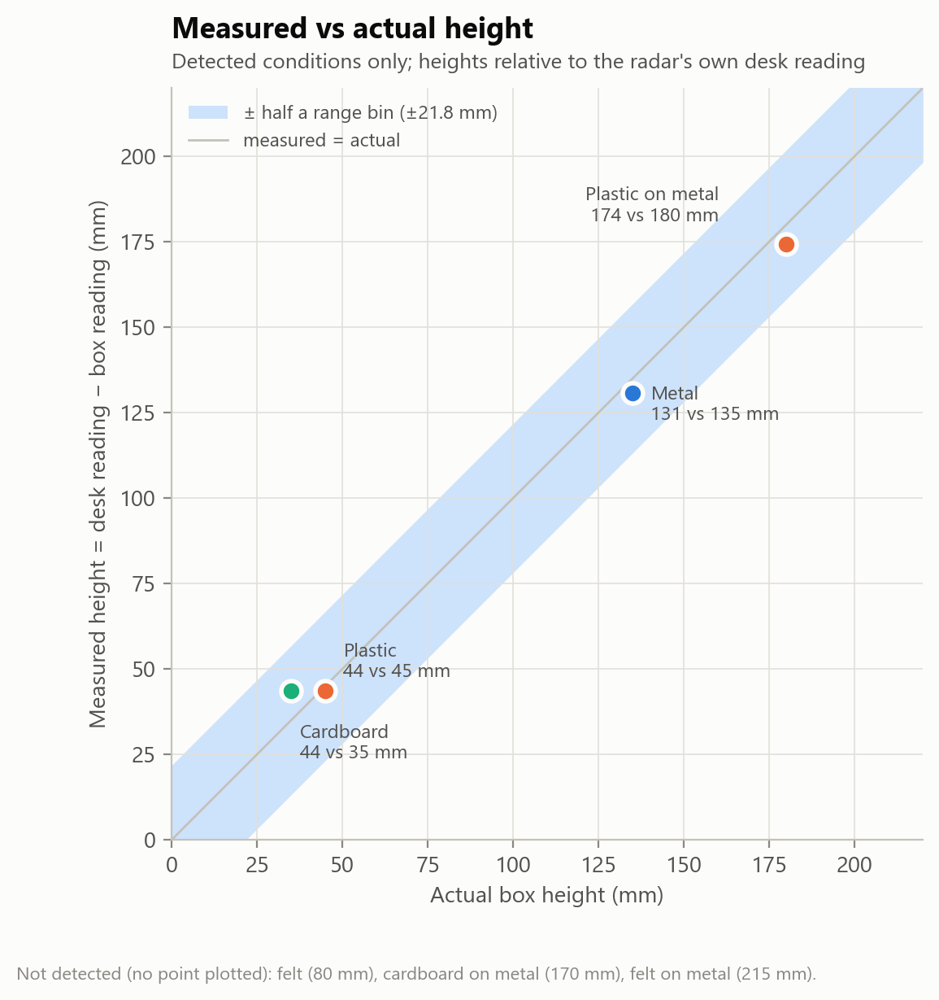
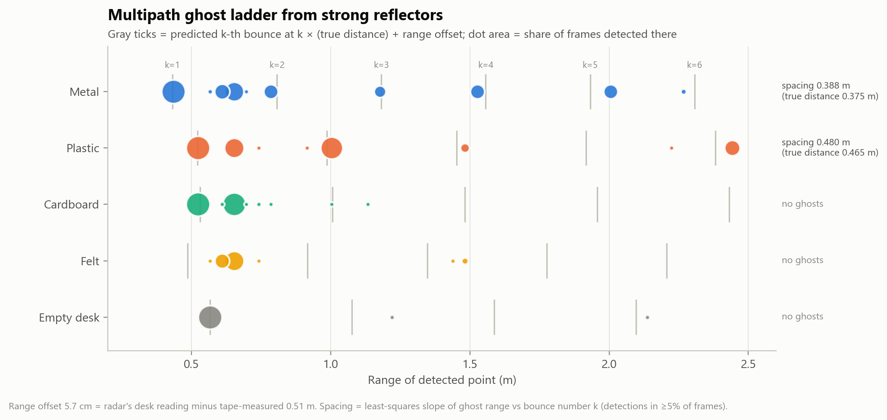

# IWR6843 Radar Distance Monitor

A Python desktop app that reads distance from a **Texas Instruments IWR6843AOP**
60 GHz mmWave radar over USB and shows it live, plus a scripted
data-collection tool and the results of a test of how different box materials
(metal, plastic, cardboard, felt) show up to the radar.



## What the GUI does

| # | Control | What it does |
|---|---------|--------------|
| 1 | **CLI port** | COM port used to send configuration commands to the radar. Auto-selects the board's "Enhanced" COM port. |
| 2 | **Data port** | COM port the radar streams its measurement data on. Auto-selects the "Standard" COM port. |
| 3 | **Refresh Ports** | Rescans for COM ports. Click it after plugging the radar in. |
| 4 | **Config file** | The radar settings file (`.cfg`) sent to the sensor when you start. Defaults to `default_config.cfg`. |
| 5 | **Browse...** | Pick a different `.cfg` file. |
| 6 | **Log readings to CSV** | When ticked, every reading is saved to `logs/radar_log_<date_time>.csv`. |
| 7 | **Connect & Start** | Opens both ports, sends the config, starts the radar and the CSV log. |
| 8 | **Stop** | Stops the radar, closes the ports and saves the CSV file. |
| 9 | **Status** | Shows *Not connected*, *Sending config...*, *Streaming* or *Stopped*. |
| 10 | **Distance readout** | **Distance to the nearest detected object, in meters.** Feet, number of objects and frame number are shown underneath. Shows `-- m` when nothing is detected or the radar isn't running. |
| 11 | **Distance history graph** | Nearest distance over the last 150 frames (about 15 s at 10 frames/s). |
| 12 | **Sensor log** | Every config command and the radar's reply. Rejected commands and the saved CSV path appear here. |

## Requirements

**Hardware**
- TI **IWR6843AOPEVM** running TI's stock **mmWave SDK 3.5 Out-of-Box demo** firmware
- USB cable to a Windows PC

**Software**
- Python 3.10 or newer
- [Silicon Labs CP2105 USB-to-UART driver](https://www.silabs.com/developers/usb-to-uart-bridge-vcp-drivers).
  Without it Windows won't show any COM ports for the board.
- Python packages: `pip install -r requirements.txt` (pyserial; matplotlib is only needed for the report figures)

## Quick start

1. Plug in the radar. In Device Manager it shows up as two COM ports:
   - *Silicon Labs Dual CP2105 ... **Enhanced** COM Port*: CLI/config port
   - *Silicon Labs Dual CP2105 ... **Standard** COM Port*: data port
2. Run the GUI:
   ```
   python radar_gui.py
   ```
3. Check the two ports were picked (click **Refresh Ports** if not), then click **Connect & Start**.
4. Click **Stop** when done. With CSV logging on, the readings are in `logs/`.

The GUI opens without the radar plugged in. The port lists will just be empty.

## Collecting test data (`experiment.py`)

`experiment.py` runs labelled, fixed-length captures without the GUI. It's
what was used for the material test below. Close the GUI first, because only
one program can hold the COM ports at a time.

```
python experiment.py configure                                     # send cfg, 30 s calibration - keep area under radar EMPTY
python experiment.py trial --label metal --height-mm 135 --trial 1 # 15 s capture of one condition
python experiment.py stop                                          # stop the sensor
```

Options for `trial`: `--seconds` (default 15), `--mount-m` radar-to-floor/desk
distance (default 0.51), `--window` detection window in m (default 0.10).
Ports are auto-detected; override them with `--cli COM8 --data COM9`.

Each trial writes to `logs/experiment/`:
- `<label>_t<n>_<time>_points.csv`: every detected point in every frame (x, y, z, velocity, range, SNR, noise)
- `<label>_t<n>_<time>_profile.csv`: frame-averaged signal strength per range bin
- `summary.csv`: one row per trial (detection rate, mean/median/std distance, error, signal peak, ...)

Regenerate the report figures with:
```
python make_report_figures.py
```

## Material test results

Radar mounted 0.51 m above a desk, pointing down; boxes placed centered
underneath. 20 trials of 15 s each (~3,000 frames). The full conditions,
per-trial data and all 14 findings are in **[report/FINDINGS.txt](report/FINDINGS.txt)**.

| Condition | Detected | Radar reading | Height measured / actual | Peak signal |
|---|---|---|---|---|
| Empty desk | 100 % | 0.567 m | – | 45.4 dB |
| Metal (135 mm) | 99 % | 0.436 m | 131 / 135 mm | 48.7 dB |
| Plastic (45 mm) | 100 % | 0.523 m | 44 / 45 mm | 47.8 dB |
| Cardboard (35 mm) | 100 % | 0.523 m | 44 / 35 mm | 45.2 dB |
| Felt (80 mm) | **0 %** | not detected | – | 43.3 dB |
| Cardboard on metal | **0 %** | not detected | – | 46.3 dB |
| Plastic on metal | 89 % | 0.393 m | 174 / 180 mm | 48.5 dB |
| Felt on metal | **0 %** | not detected | – | 43.6 dB |

Key findings:
- **Fixed ~6 cm range offset.** The radar read 0.567 m for a 0.51 m desk.
  Measuring heights relative to the radar's own desk reading cancels it;
  detected heights were then within 1–9 mm of actual.
- **4.36 cm range resolution.** Readings snap to range bins, so the 35 mm and
  45 mm boxes read the same distance. Repeatability was exact at that
  resolution, with no drift over the session.
- **Felt is invisible to the radar.** It was never detected, and placed on
  the metal box it cut the metal's return by ~10 dB.
- **Cardboard is largely transparent.** The metal underneath it stayed
  visible (−2.5 dB at most).
- **Multipath ghosts.** Metal and plastic produced repeated false targets at
  multiples of their true distance, from the signal bouncing between the box
  and the radar board.

| | |
|---|---|
|  |  |
|  |  |

All seven figures are in [`report/figures/`](report/figures/).

## Troubleshooting

- **`PermissionError: Access is denied` on a COM port.** Another program is
  holding it: a second copy of the GUI, or TI's mmWave Demo Visualizer
  still connected in a browser tab (click its Disconnect button, or close
  the tab).
- **`sensorStart` rejected with "Full configuration must be provided".** One
  of the earlier config lines was rejected (look for `WARNING` in the sensor
  log), or the `.cfg` is missing a command your firmware needs. The safest
  config is one exported from TI's
  [mmWave Demo Visualizer](https://dev.ti.com/mmwavedemovisualizer) for your
  exact board: use version **3.5.x**, platform **xWR68xx_AOP**, then *Save
  Config to PC*.
- **Unreliable readings closer than ~0.5 m.** That's antenna coupling.
  `default_config.cfg` has DC range calibration enabled to reduce it. Keep
  the area in front of the radar empty for the first ~1 s after starting so
  the calibration learns the empty scene.
- **Distance shows something farther than the target.** If the target isn't
  detected (e.g. felt), the GUI shows the next object behind it. See finding
  F14 in the report.

More setup notes are in [NOTES.txt](NOTES.txt).

## Repository layout

```
radar_gui.py             Live distance GUI (Tkinter)
radar_reader.py          Serial connection, config sender, binary frame/TLV parser
experiment.py            Scripted data collection (configure / trial / stop)
make_report_figures.py   Builds report/figures/ from logs/experiment/
default_config.cfg       Working radar config (Demo Visualizer 3.5.0 export + DC calibration on)
NOTES.txt                Setup and troubleshooting notes
docs/screenshots/        GUI screenshots
report/FINDINGS.txt      Test conditions, results, findings, limitations
report/figures/          Report figures (PNG)
logs/experiment/         Raw test data (CSV)
```
